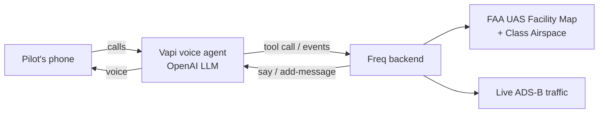

# Freq 📻
**Call a number before you fly. Freq tells you how high you can go, and calls out when to drop lower.**

> Built at c0mpiled-16 UCSD · Dispatch track · "Invisible Interfaces"
> Advisory only. Freq does not replace visual line of sight, LAANC authorization, or FAA rules.

---

## Website

This repo is the landing site plus the Google sign-in dashboard: [freq-ai.pages.dev](https://freq-ai.pages.dev).

## The problem
Drones and manned aircraft share the same low sky, and the rules for that sky change block by block.

- The FAA receives **100+ reports a month** of drones seen near airports (601 in Q2 2026).
- In the Palisades fire, a hobby drone hit a firefighting aircraft. The pilot was ordered to pay **$146,765** in restitution.
- Recreational pilots must stay under 400 ft, give way to manned aircraft, and get LAANC approval in controlled airspace. But the limit depends on the exact spot: in San Diego it can be 400 ft at La Jolla Cove, 400 ft only with LAANC at UTC, and **0 ft** a few blocks away near MCAS Miramar.

**Pain point:** to know your real limit you have to read sectional charts or open an app, while both hands are on the controller and your eyes are on the drone.

## Who it's for
- **Hobbyist pilots** who passed the TRUST test but don't read airspace maps.
- **Creators and influencers** flying for content near the coast, beaches, and cities, often near airports and bases.

## The solution
Freq is a **voice copilot on a phone call**. No app and no screen.

1. The pilot calls the Freq number and says where they are, or shares phone location.
2. Freq checks **FAA airspace data** for that exact point: airspace class, UAS Facility Map ceiling, and whether LAANC is required.
3. Freq answers out loud: *"You're in Class G. You can fly up to 400 feet."* or *"This spot is 0 feet without approval. Don't fly here."*
4. While the call stays open, Freq **watches nearby ADS-B traffic** and speaks up: *"Helicopter 2 miles north, low. Drop to 150 feet."*

It's an invisible interface: the pilot's eyes never leave the drone.

## Example (La Jolla demo route)
| Spot | What Freq says |
|---|---|
| La Jolla Cove | Class G. Up to 400 ft. |
| Torrey Pines Gliderport | Class G, 400 ft. Caution: paragliders don't broadcast ADS-B. |
| UTC | Controlled airspace. Up to 400 ft **with LAANC**. |
| Near MCAS Miramar | Ceiling 0. Do not fly. |
| North Island | Class D, ceiling 0. Do not fly. |

All values come from live FAA data, not hard-coded answers.

## How it works

- **Voice:** Vapi phone number + OpenAI model (`gpt-4.1-mini`).
- **Airspace:** FAA ArcGIS UAS Facility Map (ceiling, LAANC grid) checked first, then Class Airspace layers. Outside the grid, Class G at 400 ft AGL.
- **Traffic loop:** every few seconds the backend checks nearby aircraft and pushes a spoken advisory into the live call.
- **Web:** landing page and Google sign-in (Supabase), hosted on Cloudflare Pages.

## What makes it different
- **Hands-free, eyes-up.** Works by voice on any phone, mid-flight.
- **Exact location, not a radius.** FAA grid cells are about 1 km, so Freq uses your precise coordinates.
- **Tells you a number.** Not just "restricted," but how high you can go right now.

## Limits (honest list)
- Advisory only; not collision avoidance and not FAA approved.
- Only sees aircraft that broadcast ADS-B. Gliders, paragliders and some helicopters may not show up.
- Uses the phone's location, not the drone's. Demo is scoped to San Diego / La Jolla.

## What's next
- Read the drone's own position (Remote ID / DJI telemetry) instead of the phone's.
- One-tap LAANC request handoff.
- Fixed caution zones for known non-ADS-B activity (gliderports, firefighting TFRs).

## Team
Christian Lee, UC San Diego
